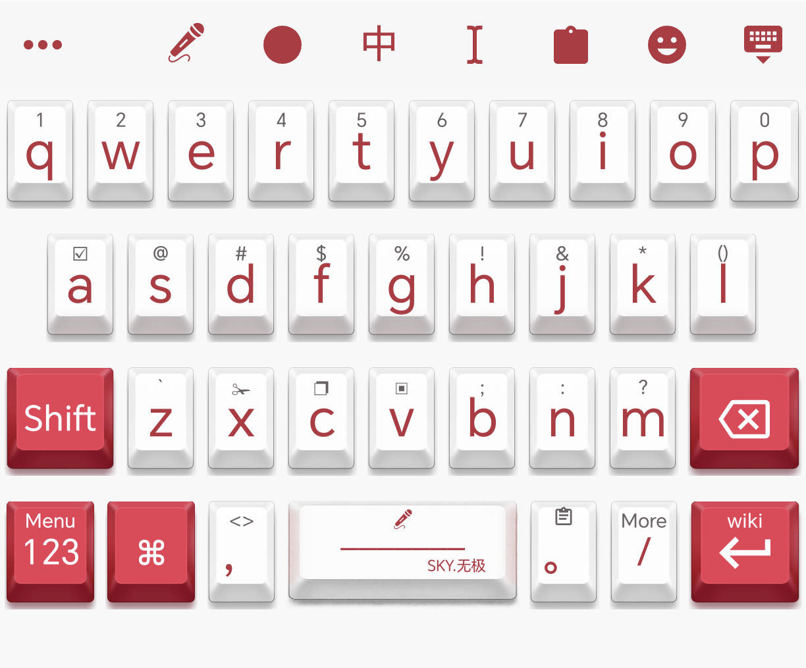

# SKY.无极输入法

由 GitHub 的 **Sky.RuoShuiJun** 基于 **同文输入法 Trime** 二创。

**沧海星辰，尽在我手！**

红白立体键帽、内置雾凇拼音中英文词库、图标工具栏与离线 wiki 使用说明。



## 下载与安装

前往 [Releases](https://github.com/skyXIANGTIAN13152/SKY-Wuji-IME/releases/latest)，下载 `SKY-Wuji-IME-1.0.2.apk`。

1. 安装 APK，打开 **SKY.无极输入法**。
2. 按页面提示，在 Android 系统设置中启用并选择它。
3. 第一次会自动准备内置词库，完成后即可输入；无需选择配置文件夹、导入主题或手动部署。

适用于 Android 5.0 及以上的 ARM64 / ARMv7 手机和平板；主题以 HONOR 90 Pro 的已确认 V6 版本为基准。采用独立包名，可与官方同文共存，不会覆盖它的词库和配置。

从本项目旧版升级时，已修改或从外部目录导入的个人配置会保留；仍未修改的内置文件自动更新。个人主题不会自动合并新版本的布局改动。

## 已内置的功能

- Cherry 风格红白立体键帽，保留同文风按键布局。
- 空格上的 **SKY.无极** 标记、Menu / More 英文提示。
- 图标形式的退格、回车、全选、剪切、复制、粘贴和麦克风。
- 长按、上滑和下滑提示常显；移除键盘上的简洁切换入口。
- 长按回车上的 **wiki** 打开离线使用说明，不跳转外部网页。
- 雾凇拼音公开词库，中英文混合输入与英文模式。

## 源码中的键盘修复（2026-10-12）

本仓库已同步 More 底栏、剪贴板卡片、横屏排版、符号与语言切换修复，以及微信中长按 A 无法全选的兼容处理。全选作用于已上屏的文字，拼音仍在候选状态时请先选词上屏。

改动和此前实测范围见 [键盘修复记录](docs/KEYBOARD_FIXES_2026-10-12.md)。这些此前仅在源码中的改动包含在 `1.0.2` 正式安装包中。

## 语音输入：说点啥

本安装包内置键盘；**说点啥应用和语音模型需要另行安装、配置一次**。

1. 从 [说点啥官方发布页](https://github.com/BryceWG/BiBi-Keyboard/releases) 安装应用，并按它的引导启用语音输入法。
2. 在说点啥中选择在线或本地语音模型，按需授予麦克风权限。使用本地模型时，可按设备内存情况开启保留已加载模型。
3. 回到 SKY.无极，点击顶部麦克风或长按空格，切换到说点啥进行语音输入。

默认优先调用已启用的说点啥；未找到时使用系统已启用的其他语音输入法。可在通用设置中更改首选语音输入法。

已声明 Android 11 及以上所需的输入法查询范围，避免因应用可见性限制将已启用的语音输入法误判为未安装。更新安装包时会检查这项声明，确保后续版本继续保留。

如果说点啥以前指定了返回到其他输入法，请把返回目标改为 **SKY.无极**，或使用返回上一个输入法的设置。

## 隐私

键盘输入在设备本地处理，本版键盘应用没有申请联网权限。发布文件不包含维护者的个人输入记录、用户词库、账号、语音录音或密钥。语音数据如何处理由所选的说点啥模型和其设置决定。

## 源码与构建

程序基于同文 3.3.12，源码遵循 GPL-3.0-or-later，词库与素材详见 [第三方说明](docs/THIRD_PARTY_NOTICES.md) 和 [来源版本](docs/UPSTREAM.json)。本项目不是同文官方发行版。

```sh
git clone --recursive https://github.com/skyXIANGTIAN13152/SKY-Wuji-IME.git
cd SKY-Wuji-IME
BUILD_ABI=armeabi-v7a,arm64-v8a make debug
```

Java、Android SDK / NDK 和完整构建步骤见 `.github/workflows/sky-wuji-build.yml`。正式 APK 使用项目独立签名；自行编译请使用自己的签名，不包含维护者的签名私钥。

发布构建复用同文 3.3.12 官方 APK 中未经修改的原生引擎库，下载时校验固定 SHA-256；Java/Kotlin 程序和本项目配置从本仓库构建。引擎对应源码由本仓库的 Git 子模块固定，获取完整源码请使用 `git clone --recursive`。不运行 `script/fetch-upstream-native.py`、保持 `app/prebuilt` 不存在时，`make debug` / `make release` 会从这些源码编译原生引擎。
